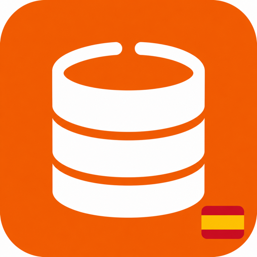

# Spain Open Data

Consulta metadatos de datos.gob.es por término y página; compara publicador, formatos, licencia y lagunas sin afirmar inspección de las distribuciones.

**Versión 0.6.0 · Conector MCP alojado e instrucciones complementarias · Sami Halawa · MIT**

## Instalación y uso

Instala el paquete en un anfitrión compatible con plugins y MCP remoto. La configuración incluida conecta `https://aiplugins.megawebs.com/mcp/spain-open-data` mediante Streamable HTTP y expone `compare_spanish_open_datasets`. No necesitas Python local, instalar dependencias ni proporcionar una clave del editor. La disponibilidad de la conexión depende del anfitrión y de la fuente pública.

> Busca datasets de vivienda en datos.gob.es con hasta seis registros.

- Busca datasets de movilidad en la página 1 con hasta cuatro registros.
- Busca hasta doce datasets de empleo y compara formatos y publicadores.

Lee [la habilidad](skills/spain-open-data/SKILL.md) para el procedimiento, [las fuentes](skills/spain-open-data/references/sources.md) y [el contrato de acceso](skills/spain-open-data/references/runtime.md). La herramienta realiza la consulta acotada descrita; la lectura de documentos, interpretación y creación de archivos usan capacidades adicionales del anfitrión. Conserva los identificadores, enlaces, fechas y límites realmente devueltos.

## Alcance

No presenta solicitudes u ofertas, no firma, no compra, no consulta datos protegidos ni activa vigilancia. Una respuesta parcial o fallida no prueba ausencia de registros. No se garantiza elegibilidad, resultado jurídico, titularidad ni financiación.

Los [ejemplos guardados](examples/demo.md) son capturas históricas de versiones anteriores, no consultas actuales. El historial de 0.5.0 conserva la edición de instrucciones; 0.6.0 añade una conexión remota explícita y no reetiqueta esas capturas. La aprobación en un directorio se verifica por separado.

[Privacidad](PRIVACY.md) · [Condiciones](TERMS.md) · [Soporte](SUPPORT.md)
