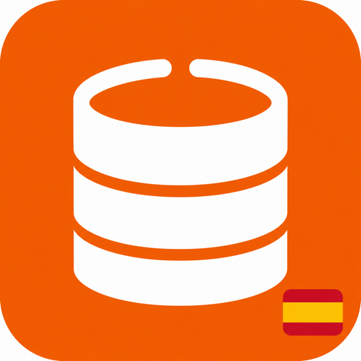

<p></p>

# Spain Open Data

## Encuentra el dataset. Comprueba si te sirve.

Encuentra datasets españoles y compara publicador, formatos, licencia y fecha antes de integrarlos en tu trabajo.

**Para:** Desarrolladores y equipos que buscan datos públicos reutilizables.

**Fuente:** datos.gob.es · **Sin cuenta adicional ni API key** · **Python 3.11+** · **MIT**

### Qué obtienes

- Identificador del dataset reutilizable en la siguiente consulta.
- Publicador, formatos y licencia en una ficha comparable.
- Metadatos encontrados separados de un fichero realmente inspeccionado.

### Pruébalo con una pregunta

> Busca datasets de empleo y compáralos por formato, licencia y fecha.

También: “Encuentra datos de mi municipio y distingue catálogo, descarga e inspección real.”

[Ver el informe de ejemplo](examples/demo.md) · [Código de la página del producto](docs/index.html) · [Flujo completo](skills/spain-open-data/references/workflow.md)

La demostración es una **captura guardada de fuentes oficiales**, no una consulta actual. Conserva fecha, enlaces y alcance.

## Instalar en Claude Code

```text
/plugin install spain-open-data --marketplace samihalawa/spain-open-data
```

O desde terminal:

```bash
claude plugin marketplace add samihalawa/spain-open-data
claude plugin install spain-open-data@spain-open-data
```

Después, pregunta en lenguaje natural o invoca `/spain-open-data:spain-open-data`.

## Ver un resultado sin conexión

Desde una copia de este repositorio:

```bash
python3 skills/spain-open-data/scripts/run.py demo
python3 skills/spain-open-data/scripts/run.py demo --format html --output ejemplo.html
```

## Consultar y guardar un informe

```bash
python3 skills/spain-open-data/scripts/run.py report open_data_search --json '{"query": "empleo", "page_size": 3}'
```

Añade `--format html --output informe.html` o `--format json`. No se sobrescriben archivos por defecto. `doctor` comprueba el entorno local sin consultar proveedores.

## Dónde funciona

| Entorno | Comportamiento |
|---|---|
| Claude Code / Codex con Python y red autorizada | Adaptadores e informes ejecutables. |
| ChatGPT con navegación/archivos | Flujo con herramientas nativas disponibles; no es un MCP alojado. |
| Sin red | Demo guardada o documentos aportados; no datos actuales inventados. |

## Alcance real

No descarga automáticamente distribuciones externas ni ejecuta archivos. No garantiza licencias o descargas vigentes. La fecha del catálogo no equivale al periodo del dato.

## Verificación

```bash
python3 -m unittest discover -s tests -v
python3 scripts/check_package.py
claude plugin validate --strict .claude-plugin/plugin.json
claude plugin validate --strict .
```

[Mejoras y crítica](CHANGELOG.md) · [Evidencia versionada](evidence/) · [Revisión de Claude](SUBMISSION.md). Los tests no equivalen a adopción. `ci/validate.yml` es una plantilla inactiva.

**English:** An independent workflow for Spanish official data, with a self-contained Python adapter, offline example and readable reports. Answer language follows the user.

**Sami Halawa** · Software independiente; sin afiliación oficial. [Privacidad](PRIVACY.md) · [Condiciones](TERMS.md) · [Soporte](SUPPORT.md) · [Seguridad](SECURITY.md).
